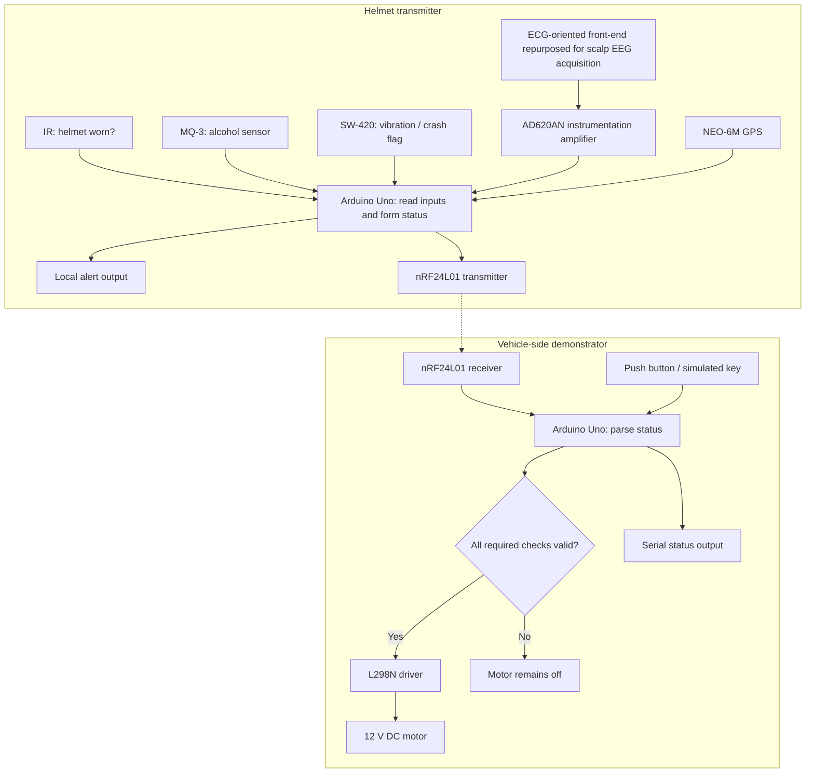

# System Architecture

This document summarizes the prototype flow described in the invention-disclosure draft, with the project's clarification that the AD620 instrumentation amplifier was used in the EEG-oriented signal chain. It is not an as-built wiring diagram.

## 1. Helmet-side transmitter

The transmitter is described around an Arduino Uno. Its inputs include:

- IR sensor module for helmet-wear status.
- MQ-3 alcohol sensor.
- SW-420 vibration sensor for abrupt movement / crash-like indication.
- An ECG-oriented biopotential front-end repurposed for EEG-oriented acquisition through scalp electrode placement, with an AD620AN instrumentation amplifier used to amplify the signal.
- NEO-6M GPS module for location acquisition during critical events.

The ECG-oriented sensor module provides the front-end signal path; the AD620 supplies amplification for the low-level biopotential input before the signal is read and used by the fatigue-related processing. The signal type depends on the physiological source/electrode placement, not on the amplifier. The exact interconnection and signal-conditioning values should be taken from the actual prototype schematic.

Sensor values / states are combined into a status payload. The draft names helmet status, alcohol state/level, crash flag, and fatigue-related information as transmitted fields. The exact binary layout, field widths, packet identifiers, and update interval are not specified in the currently documented material.

## 2. Wireless connection

The draft describes a pair of nRF24L01 radio modules operating in the 2.4 GHz band. The helmet-side module sends status data to a vehicle-side receiver. The draft does not report a measured wireless range, packet-loss rate, interference test, or end-to-end latency result.

## 3. Vehicle-side receiver

A second Arduino Uno receives the wireless payload and evaluates the incoming safety states. A push button is described as a simulated ignition-key input. The receiver drives an L298N motor-driver module and a 12 V DC motor as a bench-top representation of vehicle ignition.

The behavior described in the draft is:

- If required safety checks are satisfied, simulated ignition may be enabled.
- If alcohol is detected, helmet wear is not confirmed, a critical crash/fatigue condition is reported, or required input data is missing/weak, the motor should remain off.
- Status information is shown through serial output, with visual or local alerts for selected critical events.

The exact priority between conditions, communication timeout handling, and receiver behavior when radio packets are lost must be verified in the firmware. A real ignition controller should not be inferred from the motor-driver demonstrator.

## 4. Location and alerts

The NEO-6M GPS module is described as acquiring coordinates when a crash or high-risk fatigue state is detected, with coordinates included in an event payload. The document also discusses alert paths. It does not provide validated GPS acquisition time, location accuracy, cellular/SMS delivery results, or cloud integration measurements.

## 5. High-level data flow

## 6. Implementation evidence still required

Add these details from the actual firmware and test setup before treating this as a reproducible system:

- Exact board models and sensor module variants.
- GPIO / analog / serial pin map and wiring diagram.
- Signal-conditioning circuit, AD620 gain-setting resistor, supply/bias, filtering, and electrode placement details approved for release.
- Radio channel, data rate, payload format, retry / timeout behavior.
- Threshold definitions, filtering, and fail-safe behavior for missing sensors.
- GPS update / fix policy and exact rules for including coordinates in an alert.
- Measured end-to-end latency and results across repeated tests.
